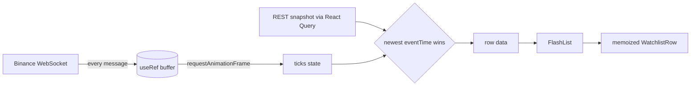
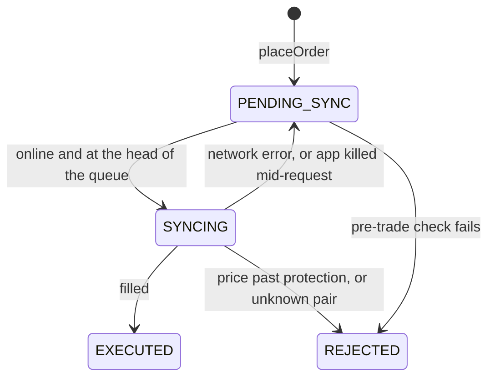

# FinPulse

A React Native trading app (Expo SDK 53, New Architecture, TypeScript) focused on the parts of a market-data client that are hard to get right: a throttled real-time price stream, a virtualized live watchlist, JSI-backed persistence and an offline-first order queue.

The UI shell started from the open-source [stock-market-app-ui-template](https://github.com/bhavyajshah/stock-market-app-ui-template) by Bhavya J Shah (MIT). Most of the template's screens still run on its mock data. The work described below is new.

| Area | What it does | Code |
| --- | --- | --- |
| Real-time stream | One multiplexed Binance socket, state flushed once per animation frame, backoff and a silence watchdog | [`hooks/useStockMarketStream.ts`](hooks/useStockMarketStream.ts) |
| Watchlist | FlashList with rows that re-render only when what they display changes | [`components/Watchlist.tsx`](components/Watchlist.tsx), [`components/WatchlistRow.tsx`](components/WatchlistRow.tsx) |
| Persistence | Zustand persisted through MMKV over JSI, synchronous hydration, optional write-behind | [`utils/mmkvStorage.ts`](utils/mmkvStorage.ts), [`store/useWatchlistStore.ts`](store/useWatchlistStore.ts) |
| Orders | Offline queue, optimistic ledger, FIFO sync, idempotent submits | [`store/useOrderStore.ts`](store/useOrderStore.ts), [`store/orderLedger.ts`](store/orderLedger.ts) |

## Running it

MMKV is a native module, so the app needs a development build. Expo Go can't load it.

Requirements: Node 18.18 or newer, plus Android Studio with an emulator or device (or Xcode for iOS).

```bash
npm install
npm run android   # or: npm run ios
```

These run `expo run:*`, which generates the native project, builds it, installs it and starts Metro. Run it again for later sessions; native builds are incremental.

```bash
npm test           # 39 Jest tests
npx tsc --noEmit   # type-checks the whole project, tests included
```

**Trying the offline queue:** open any watchlist row to reach the order ticket. Turn on airplane mode and place a few buys and sells. Balances and holdings update immediately and each order shows *Pending sync*. Turn airplane mode off and the orders execute in the order they were placed. The account starts with 10,000 USDT of paper money.

## How it works

### Price pipeline



**Stream.** `useMarketTickerStream(symbols)` subscribes to every symbol over one socket using Binance's combined stream. `useStockMarketStream(symbol)` is the single-pair form the order ticket uses.

- Incoming ticks go into a `useRef` buffer. A `requestAnimationFrame` callback moves the latest tick per symbol into state, so there is at most one render per frame however many messages arrive. The frame is scheduled only when a tick is waiting, so an idle socket costs nothing.
- The connection is keyed on the sorted symbol set. Reordering the watchlist or toggling an alert doesn't reconnect.
- Reconnects use exponential backoff from 1 s to 30 s with jitter, reset after a successful open.
- After 15 s of silence a watchdog forces a reconnect. Half-open sockets are common on mobile networks, and the OS doesn't always report them.
- The socket closes when the app goes to the background and reopens when it returns.

Binance's `@ticker` channel pushes about once per second per symbol. Frame batching matters most when one socket carries a whole watchlist, and it keeps render cost flat on a higher-frequency channel such as `@aggTrade`.

**Watchlist.**

- `FlashList` (v1) is configured with an `estimatedItemSize` equal to the fixed 72 px row height, a `keyExtractor` on the symbol, and a `getItemType` that separates rows still waiting for their first quote (a skeleton) from quoted rows, so the two layouts recycle from separate pools.
- Row objects are rebuilt every flushed frame, so `React.memo`'s default shallow compare would re-render every visible row whenever any symbol ticked. `areWatchlistRowPropsEqual` compares the formatted strings that actually reach the screen instead. A tick on another symbol, or a move below display precision, skips the render.
- Prices come from a REST snapshot merged with live ticks. Whichever has the newer exchange timestamp wins, so a slow refetch can't roll a price back.
- Pull-to-refresh ([`hooks/useRefreshControl.ts`](hooks/useRefreshControl.ts)) drives the spinner from its own state rather than the query's `isFetching`, so background refetches never show it. The list keeps its current data while refreshing, overlapping pulls are ignored, and the spinner stays up at least 600 ms so a fast refresh doesn't flash. A pull also reconnects a socket that is waiting out a backoff.
- The add-pair input lives in a memoized header component, so typing doesn't re-render the list.

### Persistence

`createMMKVStorage()` implements Zustand's `PersistStorage` directly on MMKV. MMKV reads are synchronous over JSI, so stores hydrate inside `create()` and the first render already has persisted data, with no hydration flash.

Stores choose how they write:

- **Write-behind** (watchlist): updates apply in memory immediately. Serialization and the disk write follow 250 ms later, coalesced into one write, and are flushed whenever the app leaves the foreground. Reads check unflushed values first.
- **Write-through** (orders): an order the user has been told is queued must already be on disk.

The watchlist store exposes `addSymbol`, `removeSymbol`, `toggleAlert` and `reorderWatchlist`. `addSymbol` is optimistic: the row appears immediately and the pair is validated against Binance in the background. An unknown pair is rolled back, matched by its timestamp so a later re-add of the same symbol isn't removed.

### Offline order queue



- **Ledger model.** The store keeps `settled` balances confirmed by the broker and derives `optimistic` by replaying queued orders on top of them, in order. To reject an order it drops the order from the queue and replays. There's no hand-written reversal of average-cost math, which gets the cost basis wrong when orders interleave.
- **No overdraft.** A market buy holds cash at a 2% protection price. The fill settles at the real price and releases the difference, and the broker rejects a fill beyond the protection price.
- **Sync.** NetInfo (going online) and AppState (returning to the foreground) trigger a single serialized drain. Orders go out strictly first-in, first-out. A network error leaves the order at the head of the queue and retries with backoff from 2 s to 60 s, so later orders can't jump ahead of it.
- **Conflicts.** Before each submit, the order is re-checked against confirmed balances, since an earlier order may have been rejected or filled at a worse price. Fills settle at the broker's price, and the toast says when that differs from the price the user saw.
- **Idempotency.** Every order carries a client-generated id. If the app dies after the broker accepted an order but before the result was saved, the order comes back as `PENDING_SYNC` and the resubmit returns the original fill instead of filling twice.

Only `settled`, `orders` and `queue` are persisted. `optimistic` is recomputed on load.

There is no brokerage backend. [`services/orderApi.ts`](services/orderApi.ts) stands in for one: it fills market orders at Binance's live last price and honours client order ids. It keeps that idempotency record in memory, where a real gateway would persist it on the server.

## Code map

```
app/trade/[symbol].tsx          Order ticket: live price, balances, order status
app/watchlist.tsx               Watchlist screen
components/Watchlist.tsx        FlashList watchlist and the home-screen preview
components/WatchlistRow.tsx     Memoized row with a display-level comparator
hooks/useStockMarketStream.ts   Binance ticker stream
hooks/useWatchlistQuotes.ts     Merges the REST snapshot with live ticks
hooks/useRefreshControl.ts      Pull-to-refresh state
services/binance.ts             Binance REST client
services/orderApi.ts            Simulated order gateway
store/orderLedger.ts            Pure ledger math, no React Native imports
store/useOrderStore.ts          Offline order queue
store/useWatchlistStore.ts      Persisted watchlist
utils/mmkvStorage.ts            Zustand PersistStorage over MMKV
*/__tests__/                    Jest suites next to the code they cover
```

## Tests

The suites cover the behaviour this README claims, not just the happy path:

- **Order ledger:** protection-price holds, rollback by replay keeping average cost correct, settlement at the fill price, floating-point dust.
- **Order queue:** optimistic offline placement, first-in first-out drain, a rejection releasing its hold, a queued sell rejected after the buy it depended on fails, network failures blocking the head of the queue, and in-flight orders recovering after an app kill.
- **Order gateway:** price protection, idempotent resubmits, and unknown pairs rejected while network errors propagate for retry.
- **Stream hook:** driven through a fake WebSocket. A burst of 100 ticks renders once on the next frame, a closed socket reconnects with backoff, 15 s of silence forces a reconnect, and reordering symbols keeps the same socket.
- **Watchlist:** optimistic add with rollback, and a row comparator that skips renders below display precision.

MMKV ships an in-memory mock for Jest, so the persisted stores run unmodified in tests.

## Limitations and next steps

- **Crypto only.** Live data comes from Binance, which lists no equities. The template's stock screens still use mock data.
- **Alerts are a stored preference.** `toggleAlert` persists the flag, but nothing evaluates alerts yet.
- **Market orders only,** against a simulated gateway.
- **Two sockets.** The home preview and the watchlist screen each open their own connection while both are mounted. A shared, reference-counted connection manager would merge them.
- **No lint config yet.** A one-off `react-hooks` lint pass is clean for rules-of-hooks, but a few template screens still have `exhaustive-deps` warnings.

## License

MIT. The original template's copyright notice is kept in [`LICENSE.txt`](LICENSE.txt).
